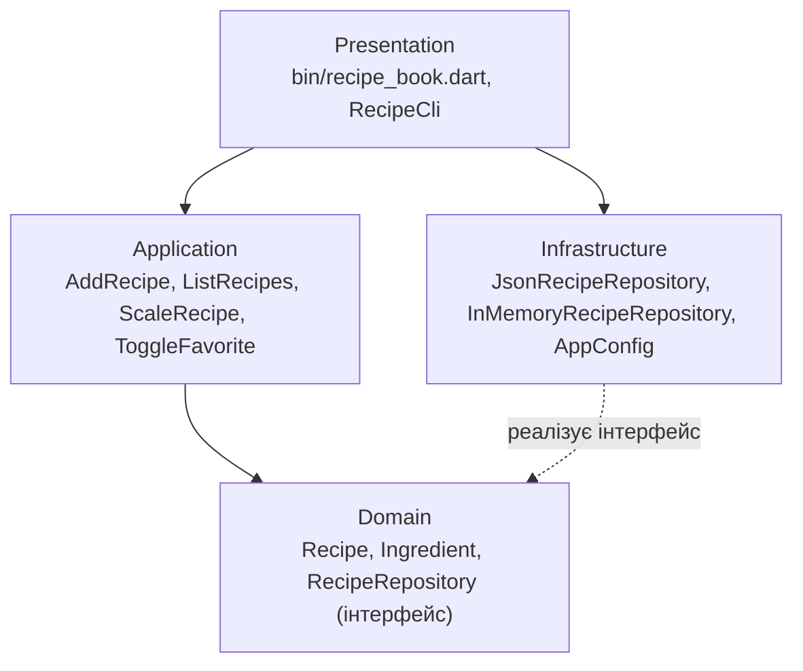

# recipe-book

Консольна книга рецептів на Dart, побудована за принципами Clean Architecture (лабораторна робота 5).

Можливості: список рецептів, обране, перерахунок інгредієнтів на потрібну кількість порцій, додавання нового рецепта.

## Архітектура

Залежності спрямовані тільки всередину: зовнішні шари знають про внутрішні, а Domain не знає ні про кого.



| Шар | Що містить | Від чого залежить |
|---|---|---|
| Domain | сутності `Recipe`, `Ingredient`, бізнес-правила, інтерфейс `RecipeRepository` | ні від чого |
| Application | use cases, які працюють тільки через `RecipeRepository` | Domain |
| Infrastructure | `InMemoryRecipeRepository`, `JsonRecipeRepository`, маппер JSON, `AppConfig` | Domain |
| Presentation | консольне меню `RecipeCli` і точка входу, де через DI збираються всі шари | усі шари |

```
lib/src/
  domain/        entities/, errors/, interfaces/recipe_repository.dart
  application/   use_cases/
  infrastructure/ repositories/, mappers/, config/, sample_data.dart
  presentation/  cli/recipe_cli.dart
bin/recipe_book.dart     точка входу (composition root)
config/appsettings.json  тип сховища, шлях до файлу даних, порції за замовчуванням
test/                    тести use cases з фейковим репозиторієм
```

Щоб змінити спосіб зберігання, достатньо поміняти `"storage"` в `config/appsettings.json` (`memory` або `json`): use cases при цьому не змінюються.

## Збірка і запуск

Потрібен Dart SDK 3.5+ (або Flutter, у ньому Dart уже є).

```
dart pub get
dart run bin/recipe_book.dart
dart test
```

У консолі Windows для коректної кирилиці спершу виконайте `chcp 65001`.

## Політика гілок

| Гілка | Призначення |
|---|---|
| `main` | тільки стабільний код, з якого роблять релізи (теги `vX.Y.Z`) |
| `develop` | інтеграційна гілка, сюди зливаються всі задачі |
| `feature/*` | окрема гілка під кожну задачу, створюється від `develop` і повертається туди через pull request |

Повідомлення комітів пишемо за [Conventional Commits](https://www.conventionalcommits.org/): `feat`, `fix`, `refactor`, `test`, `docs`, `chore`.
